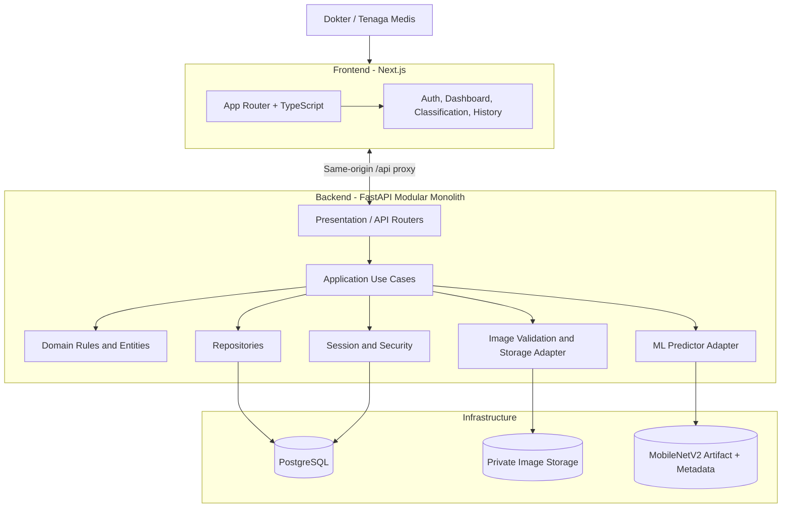

# 03 — SYSTEM ARCHITECTURE DAN STRUKTUR FOLDER

**Versi:** 2.0  
**Arsitektur:** Monorepo + modular monolith backend + feature-first frontend  
**Stack:** Next.js, FastAPI, TensorFlow/Keras, PostgreSQL, Docker Compose

## 1. Ringkasan arsitektur

Aplikasi terdiri dari dua aplikasi utama dalam satu repository:

1. **Frontend:** Next.js App Router + TypeScript + Tailwind CSS + shadcn/ui.
2. **Backend:** FastAPI sebagai modular monolith. Backend menangani autentikasi, validasi file, use case klasifikasi, persistence, dan pemanggilan model.

TensorFlow/Keras tidak dijalankan di browser. Model di-load oleh backend satu kali pada startup/lifecycle dan dipanggil melalui interface predictor. PostgreSQL menyimpan akun, session, metadata prediksi, dan versi model. File gambar berada pada private storage.

## 2. Diagram arsitektur



## 3. Keputusan penting

- **Tidak menggunakan microservices** untuk MVP.
- **Tidak menggunakan Streamlit** pada aplikasi utama. Eksperimen dapat dilakukan melalui notebook/script Python.
- **Tidak ada ML API terpisah** pada tahap awal. FastAPI memanggil predictor di dalam proses backend.
- **Tidak ada browser-side inference.** Model dan bobot tidak dikirim ke pengguna.
- Frontend hanya menerima label, skor output, waktu proses, dan metadata model yang aman.
- Database dan file storage tidak boleh dapat diakses publik tanpa backend authorization.

## 4. Struktur monorepo yang direkomendasikan

```text
cataract-classification-system/
├── AGENTS.md
├── README.md
├── .gitignore
├── .env.example
├── docker-compose.yml
├── docs/
│   ├── 00_DECISION_LOG.md
│   ├── 01_SRS.md
│   ├── 02_UML_DAN_WORKFLOW.md
│   ├── 03_ARCHITECTURE_DAN_STRUKTUR_FOLDER.md
│   ├── 04_DATABASE_ERD_DAN_DATA_DICTIONARY.md
│   ├── 05_UI_UX_SPECIFICATION.md
│   ├── 06_API_CONTRACT.md
│   ├── 07_MACHINE_LEARNING_PIPELINE.md
│   ├── 08_SECURITY_PRIVACY_DAN_DATA_GOVERNANCE.md
│   ├── 09_QA_TEST_PLAN.md
│   ├── 10_ROADMAP_DAN_TRACEABILITY.md
│   ├── 11_DEVOPS_ENVIRONMENT_DAN_DEPLOYMENT.md
│   └── 12_AI_AGENT_GUIDE.md
├── apps/
│   ├── web/
│   │   ├── public/
│   │   ├── src/
│   │   │   ├── app/
│   │   │   │   ├── (auth)/login/page.tsx
│   │   │   │   ├── (app)/layout.tsx
│   │   │   │   ├── (app)/dashboard/page.tsx
│   │   │   │   ├── (app)/classifications/new/page.tsx
│   │   │   │   ├── (app)/classifications/[id]/page.tsx
│   │   │   │   ├── (app)/history/page.tsx
│   │   │   │   ├── (app)/history/[id]/page.tsx
│   │   │   │   ├── layout.tsx
│   │   │   │   ├── globals.css
│   │   │   │   └── page.tsx
│   │   │   ├── features/
│   │   │   │   ├── auth/{api,components,hooks,schemas,types}/
│   │   │   │   ├── dashboard/{api,components,types}/
│   │   │   │   ├── classifications/{api,components,schemas,types}/
│   │   │   │   └── history/{api,components,types}/
│   │   │   ├── shared/
│   │   │   │   ├── components/ui/
│   │   │   │   ├── components/layout/
│   │   │   │   ├── lib/api/
│   │   │   │   ├── lib/utils/
│   │   │   │   └── types/
│   │   ├── e2e/
│   │   ├── components.json
│   │   ├── next.config.ts
│   │   ├── package.json
│   │   └── tsconfig.json
│   └── api/
│       ├── app/
│       │   ├── main.py
│       │   ├── core/{config.py,security.py,logging.py,exceptions.py}
│       │   ├── shared/{types.py,constants.py}
│       │   ├── modules/
│       │   │   ├── auth/
│       │   │   │   ├── domain/
│       │   │   │   ├── application/
│       │   │   │   ├── infrastructure/
│       │   │   │   └── presentation/
│       │   │   ├── classifications/
│       │   │   │   ├── domain/
│       │   │   │   ├── application/
│       │   │   │   ├── infrastructure/
│       │   │   │   └── presentation/
│       │   │   ├── dashboard/
│       │   │   └── model_registry/
│       │   ├── integrations/ml/{contracts.py,keras_predictor.py,model_loader.py}
│       │   └── infrastructure/
│       │       ├── database/{base.py,session.py,models/}
│       │       └── storage/{local_private_storage.py,contracts.py}
│       ├── migrations/
│       ├── tests/{unit,integration}/
│       ├── alembic.ini
│       └── pyproject.toml
├── ml/
│   ├── README.md
│   ├── configs/
│   ├── data/
│   │   ├── raw/.gitkeep
│   │   ├── interim/.gitkeep
│   │   ├── processed/.gitkeep
│   │   └── manifests/.gitkeep
│   ├── notebooks/
│   ├── src/cataract_ml/
│   │   ├── data/{audit.py,manifest.py,split.py}
│   │   ├── preprocessing/{pipeline.py,validation.py}
│   │   ├── training/{dataset.py,model.py,train.py}
│   │   ├── evaluation/{metrics.py,plots.py,report.py}
│   │   └── export/{export_model.py,write_metadata.py}
│   ├── tests/
│   ├── artifacts/.gitkeep
│   └── reports/.gitkeep
├── infra/
│   └── docker/{Dockerfile.web,Dockerfile.api}
├── scripts/{create_doctor.py,check_model_artifact.py}
└── storage/                 # private volume; ignored by Git
```

`{a,b}` pada diagram tree adalah ringkasan folder; agent boleh membuat file aktual secara bertahap. Jangan membuat semua file kosong hanya demi mengikuti tree.

## 5. Pembagian tanggung jawab

### 5.1 Frontend

- Menyediakan halaman dan komponen UI.
- Validasi UX awal; backend tetap memvalidasi ulang.
- Mengirim file melalui `multipart/form-data`.
- Menampilkan state loading, success, empty, dan error.
- Tidak memuat TensorFlow, file model, atau logika preprocessing.
- Tidak menganggap hasil sebagai diagnosis.
- Memanggil API melalui path same-origin `/api/v1`.

### 5.2 Backend

- Autentikasi, session, dan authorization.
- Validasi upload.
- Mengelola use case klasifikasi.
- Memanggil predictor melalui interface.
- Menyimpan file privat dan record PostgreSQL.
- Menyediakan riwayat, detail, dashboard, dan model metadata.
- Menyaring record berdasarkan user/session.

### 5.3 ML package

- Audit dataset dan manifest.
- Split data dan mencegah leakage.
- Training dan evaluasi.
- Ekspor artefak dan metadata model.
- Tidak mengakses DB aplikasi atau mengurus HTTP.

### 5.4 Database dan storage

- SQLAlchemy untuk persistence.
- Alembic untuk migration.
- Storage adapter agar local private storage bisa diganti tanpa merombak domain.
- File path tidak dibuka langsung sebagai URL publik.

## 6. Prinsip desain

1. **Feature-first:** file frontend dikelompokkan berdasarkan fitur.
2. **Separation of concerns:** presentation, application, domain, infrastructure dipisahkan.
3. **Dependency direction:** domain tidak mengimpor FastAPI, SQLAlchemy, atau TensorFlow.
4. **Adapter pattern:** ML predictor dan file storage diakses melalui interface.
5. **Single source of truth:** model metadata menentukan input size, channel order, normalization, class mapping, dan versi.
6. **No hidden magic:** parameter model tidak boleh disalin manual ke frontend.
7. **Fail safely:** file/model/database error tidak menghasilkan hasil palsu.
8. **Small modules:** hindari overengineering; jangan membuat service/repository abstrak tanpa kebutuhan nyata.

## 7. Frontend architecture

- Gunakan Next.js App Router.
- Page/layout server component secara default; gunakan client component hanya untuk interaksi (upload, form, table filters, dialogs).
- Pisahkan API calls dalam feature-specific `api/`.
- Shared UI primitives di `shared/components/ui`.
- Hindari fetch langsung berulang di komponen; gunakan API client bersama.
- Gunakan TypeScript strict mode.
- Validasi form frontend boleh memakai Zod, tetapi server tetap sumber validasi akhir.

Dokumentasi App Router dan Server/Client Components: https://nextjs.org/docs/app dan https://nextjs.org/docs/app/getting-started/server-and-client-components. FastAPI mendukung pemisahan router ke beberapa file untuk aplikasi lebih besar: https://fastapi.tiangolo.com/tutorial/bigger-applications/.

## 8. Backend architecture

Untuk setiap modul, gunakan layer hanya bila relevan:

- `domain`: entities, enums, aturan bisnis, interface repository.
- `application`: use cases/orchestration.
- `infrastructure`: SQLAlchemy repository, storage adapter, predictor implementation.
- `presentation`: FastAPI router dan Pydantic schemas.

Jangan meletakkan semua logika di route handler. Route hanya autentikasi dependency, parse request, panggil use case, dan bentuk response.

## 9. ML inference adapter

Kontrak konseptual:

```python
class Predictor(Protocol):
    def predict(self, image_array: np.ndarray) -> PredictionOutput: ...
    def health(self) -> ModelHealth: ...
```

`KerasPredictor` mengimplementasikan interface, memuat model satu kali, memegang metadata model, memvalidasi shape, menjalankan `model.predict`, lalu mengembalikan skor dan model version. API tidak boleh menebak class index atau preprocessing.

## 10. Batas tanggung jawab dan larangan

- Jangan menambah Redis/Celery/Kubernetes/microservices tanpa kebutuhan yang teruji.
- Jangan menyimpan file ke `apps/web/public`.
- Jangan menyimpan secret atau data klinis di Git.
- Jangan membuat akun admin/role baru tanpa perubahan SRS.
- Jangan mengubah metode atau sumber data penelitian tanpa catatan dan persetujuan.
